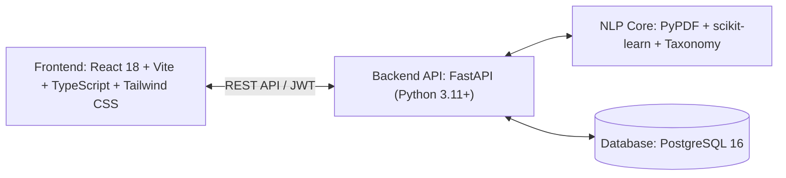

# CareerFit • Resume Analyzer & Job Match Recommender

> **"Know Your Fit. Build Your Career."**
> A full-stack AI/Career-Tech SaaS platform engineered for college students and fresh graduates.

---

## 🌟 Key Features

1. **Multi-Format Resume Parsing (PDF & DOCX):**
   - Extracts candidate identity, education, experience, projects, links, and certifications using `pdfplumber`, `pypdf`, and `python-docx`.
2. **Explainable Multi-Factor Resume Scoring:**
   - 100% transparent formula: $40\%\text{ (Skills)} + 20\%\text{ (Experience)} + 20\%\text{ (Projects)} + 10\%\text{ (Education)} + 10\%\text{ (Structure)}$.
   - Zero opaque numbers or hardcoded scores.
3. **Curated Skill Taxonomy & NLP Engine:**
   - Over 1,200+ technology and soft skill aliases mapped across 9 domains (Programming Languages, Frameworks, Databases, Cloud/DevOps, AI/ML, Data Analytics, Web, Tools, Soft Skills).
4. **Instant Semantic Job Matching:**
   - Evaluates target job descriptions against resume profiles.
   - Categorizes requirements into **Matched (Green)**, **Partial (Amber)**, and **Missing (Red)** skills.
   - Computes Direct Skills Match ($50\%$), Experience Fit ($20\%$), Project Practicality ($15\%$), and TF-IDF Cosine Similarity ($15\%$).
5. **Dynamic 5-Stage Career Roadmap:**
   - Personalized progression tree (Foundations $\to$ Frameworks $\to$ Applied Projects $\to$ DevOps Deployment $\to$ Placement Readiness) with actionable deliverables.
6. **Context-Aware Resume Optimizer:**
   - Before/after comparisons transforming passive phrasing into high-impact metric statements.
7. **Longitudinal Progress Tracking:**
   - Interactive historical growth charts with score deltas ($+8\text{ pts}$).
8. **Student Gamification Hub:**
   - XP progression, dynamic student tiers (*Career Explorer* to *Placement Ace*), daily streaks, and verified milestone badge unlocks.
9. **Selective 3D & Mobile-First Interface:**
   - Interactive Three.js / React Three Fiber hero canvas with automatic 2D CSS/SVG fallback for low-resource devices.

---

## 🏗️ Architecture & Tech Stack



- **Frontend:** React 18, Vite, TypeScript, Tailwind CSS, Lucide Icons, Framer Motion, Three.js, React Three Fiber, Recharts, Canvas Confetti.
- **Backend:** Python 3.11+, FastAPI, SQLAlchemy, PostgreSQL, Psycopg3, Pydantic v2, PyPDF, pdfplumber, python-docx, scikit-learn, bcrypt, python-jose.
- **Database:** PostgreSQL 16.

---

## 🚀 How to Run Locally

### 1. Prerequisites
- **Python 3.11+**
- **Node.js v18+** & **npm**
- **Docker Desktop** (or native PostgreSQL server running on port 5432)

---

### 2. Start PostgreSQL Database
From the root directory:
```bash
docker compose up -d
```
*(The PostgreSQL container will run on port `5432` with database `careerpath_db` and user `careerpath_user`).*

---

### 3. Start Backend Server (FastAPI)
Open a terminal in `careerpath/backend`:

```powershell
# 1. Activate Python virtual environment
.\venv\Scripts\activate

# 2. Initialize database tables and seed baseline reference catalog
python -m app.core.init_db

# 3. Start FastAPI server on port 8000
python -m uvicorn app.main:app --reload --port 8000
```
- **Backend API:** [http://127.0.0.1:8000](http://127.0.0.1:8000)
- **Interactive Swagger Docs:** [http://127.0.0.1:8000/api/v1/docs](http://127.0.0.1:8000/api/v1/docs)

---

### 4. Start Frontend Application (Vite + React)
Open a second terminal in `careerpath/frontend`:

```powershell
# Start Vite development server on port 5173
npm run dev
```
- **Frontend App:** [http://localhost:5173](http://localhost:5173)

---

## 🧪 Running Automated Tests

Run the complete backend test suite covering authentication, document parsing, NLP extraction, and explainable job matching:

```powershell
cd backend
.\venv\Scripts\python -m pytest
```

---

## 📂 Project Directory Structure

```
careerpath/
├── docker-compose.yml           # PostgreSQL 16 container definition
├── .env.example                 # Environment variables template
├── README.md                    # System architecture and setup documentation
├── backend/
│   ├── app/
│   │   ├── main.py              # FastAPI app & CORS configuration
│   │   ├── core/                # Config, database session, bcrypt security, deps
│   │   ├── models/              # SQLAlchemy relational models
│   │   ├── schemas/             # Pydantic validation schemas
│   │   ├── services/            # Parser, NLP, Scoring, Matcher, Roadmap, Gamification
│   │   ├── utils/               # 1,200+ skill taxonomy & text cleaner
│   │   └── api/v1/              # Auth, Resumes, Jobs, Matches, Roadmap, History, Achievements
│   ├── tests/                   # Pytest test suite
│   └── requirements.txt         # Python dependencies
└── frontend/
    ├── src/
    │   ├── components/          # Common, 3D, Layout, Dashboard, Analyzer, Matcher
    │   ├── pages/               # Landing, Login, Register, Dashboard, Analyzer, Matcher, Roadmap...
    │   ├── context/             # AuthContext session state
    │   ├── services/            # Axios API clients
    │   └── types/               # TypeScript interfaces
    ├── package.json
    ├── tailwind.config.js
    └── vite.config.ts
```
